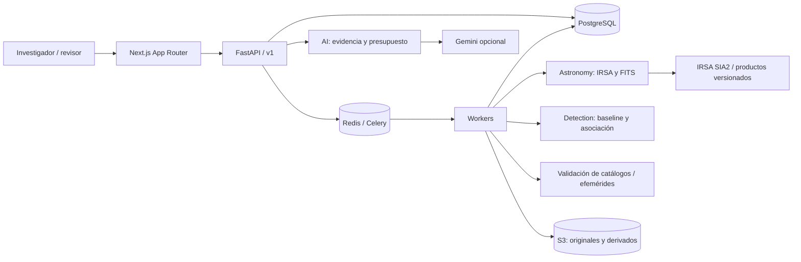

# Arquitectura propuesta

## Decisión principal

Monorepo con backend modular y workers separados por proceso. Astronomy, detection y
AI son paquetes Python, no microservicios HTTP independientes. Esto evita contratos
de red y despliegues innecesarios durante el MVP. Solo API y workers acceden a SQL/S3.
El frontend nunca recibe claves del proveedor ni acceso directo a Redis.

El diagrama describe el destino, no el despliegue implementado. Hoy solo están
operativos FastAPI y la construcción determinista de URLs de consulta.

## Responsabilidades y dependencias

| Límite | Entrada → salida | Regla |
| --- | --- | --- |
| web | contratos API → visualización | Next.js, React, TS, Tailwind, shadcn/ui; Aladin/Plotly solo cliente |
| api | JSON validado → consultas/jobs | autenticación y autorización antes de escrituras públicas |
| astronomy | productos versionados → arrays/WCS/máscaras | no depende de API, frontend ni Gemini |
| detection | mediciones/errores/épocas → asociaciones | no importa código LLM |
| ai | expediente cerrado → explicación citada | no altera medidas ni estados científicos |
| workers | identificadores de job → artefactos persistidos | mensajes JSON pequeños; nunca enviar FITS por Redis |
| shared | OpenAPI → cliente generado | no duplicar manualmente esquemas Python y TypeScript |

## Flujo científico y trazabilidad

1. Validar región ICRS, radio y rango temporal explícito en MJD.
2. Consultar metadatos de productos por colección; conservar respuesta y fecha.
3. Descargar desde hosts IRSA permitidos, con límites de tamaño y tiempo;
   validar redirecciones, checksum SHA-256 y producto. Evitar URLs arbitrarias.
4. Registrar HDUs, release, calibración, unidades, época/escala temporal, WCS,
   respuesta espectral local, incertidumbres y máscaras. Rechazar entradas ambiguas.
5. Aplicar compuerta de compatibilidad espectral/PSF/calibración y solapamiento.
6. Extraer fuentes, registrar incertidumbre y alinear propagando ruido correlacionado.
7. Asociar con épocas reales y geometría esférica. Ajustar trayectoria y guardar
   residuos, hipótesis y alternativas. Dos épocas son indicio, no confirmación.
8. Consultar catálogos/efemérides con época y posición del observador correctas.
9. Persistir expediente versionado; revisión humana; resumen opcional con evidencia.

## Jobs y almacenamiento

PostgreSQL es la autoridad de estados: queued → running → succeeded/failed/cancelled.
Una reejecución crea un nuevo job con parámetros versionados. Clave idempotente:
hash de entradas/checksums + configuración + commit + versión de calibración.
Planificar outbox transaccional para evitar jobs persistidos sin encolado.
Reintentar solo fallos transitorios, con backoff y límite; DLQ/estado failed visible.
Celery puede entregar más de una vez: publicar derivados por clave inmutable y
confirmar resultados de forma idempotente. Timeout de visibilidad superior al límite
de tarea; recuperación explícita de jobs abandonados.

S3 conserva originales inmutables, máscaras, miniaturas, reportes y manifiestos.
PostgreSQL almacena referencias; Redis solo caché/cola. Separar caché de broker en
producción. URLs firmadas de corta duración para artefactos privados. Versionar
esquema con Alembic antes de la primera evolución persistente.

## Copiloto y presupuesto propuesto

Deshabilitado por defecto. Elegir modelo Flash y precios solo tras verificar la
documentación vigente del proveedor. USD 4 es un techo configurable, no una tarifa.
Reservar coste máximo en transacción serializada antes de cada llamada; rechazar si
consumido + reservas + coste máximo supera el techo. Registrar tokens y conciliar
respuesta; llamadas con resultado desconocido conservan reserva. Reintentos consumen
reservas propias. Cuotas por usuario, límites de concurrencia y rate limiting.
Caché por hash de evidencia/modelo/prompt. Clave solo backend; nunca NEXT_PUBLIC_.
Tratar metadatos, notas y respuestas externas como datos no confiables. Respuestas
con referencias a IDs reales; rechazar afirmaciones sin evidencia verificable.

## Operación y seguridad

Producción pendiente: TLS, OIDC, RBAC, CORS por origen exacto, protección CSRF si se
usan cookies, cuotas de descarga y CPU, almacenamiento privado y gestión de secretos.
Revisores no cambian medidas; moderadores administran revisión sin confirmar descubrimientos.
Logs JSON con request_id/job_id, sin claves ni prompts privados. Medir latencia de
cola, fallos de archivo, tiempo por etapa y gasto reservado/consumido. Backups SQL y
prueba de restauración más retención/lifecycle de objetos antes de uso público.

## Dependencias por fase

`uv.lock` fija el entorno Python. Extras `astronomy` y `workers` son opcionales y no
prueban integración operativa. Astroquery, OpenCV, scikit-image, sklearn y PyTorch se
añadirán solo si un experimento justifica su uso. TanStack Query para estado remoto;
Zustand solo si la interacción local lo requiere. Frontend: Node 22 LTS propuesto,
lockfile y versiones verificadas al implementarlo. No añadir dependencias decorativas.
