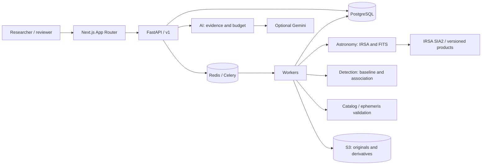

# Proposed architecture

## Main decision

A monorepo with a modular backend and workers in separate processes. Astronomy,
detection, and AI are Python packages, not independent HTTP microservices. This
avoids unnecessary network contracts and deployments during the MVP. Only the API
and workers access SQL/S3. The frontend never receives provider keys or direct Redis access.

This diagram describes the target. Only FastAPI and deterministic query URL
construction are currently operational.

## Responsibilities and dependencies

| Boundary | Input → output | Rule |
| --- | --- | --- |
| web | API contracts → visualization | Next.js, React, TS, Tailwind, shadcn/ui; client-only Aladin/Plotly |
| api | Validated JSON → queries/jobs | Authentication and authorization before public writes |
| astronomy | Versioned products → arrays/WCS/masks | Independent of API, frontend, and Gemini |
| detection | Measurements/errors/epochs → associations | Does not import LLM code |
| ai | Completed dossier → cited explanation | Does not alter measurements or scientific states |
| workers | Job IDs → persisted artifacts | Small JSON messages; never send FITS through Redis |
| shared | OpenAPI → generated client | Do not manually duplicate Python and TypeScript schemas |

## Scientific workflow and traceability

1. Validate the ICRS region, radius, and explicit MJD interval.
2. Query product metadata by collection; preserve the response and date.
3. Download from allowed IRSA hosts with size/time limits; validate redirects,
   SHA-256 checksum, and product. Reject arbitrary URLs.
4. Record HDUs, release, calibration, units, epoch/time scale, WCS, local spectral
   response, uncertainties, and masks. Reject ambiguous inputs.
5. Apply spectral/PSF/calibration compatibility and overlap checks.
6. Extract sources, record uncertainties, and align while propagating correlated noise.
7. Associate using actual epochs and spherical geometry. Fit trajectories and retain
   residuals, assumptions, and alternatives. Two epochs are an indication, not confirmation.
8. Query catalogs/ephemerides with the correct epoch and observer position.
9. Persist a versioned dossier, support human review, and optionally summarize evidence.

## Jobs and storage

PostgreSQL owns state: queued → running → succeeded/failed/cancelled. Reruns create
new jobs with versioned parameters. The idempotency key hashes input checksums,
configuration, commit, and calibration version. Plan a transactional outbox to avoid
persisted jobs that are never enqueued. Retry only transient failures with bounded
backoff; expose a dead-letter queue or failed state. Celery may deliver more than once:
publish derivatives under immutable keys and commit results idempotently. Set visibility
timeout above the task time limit and explicitly recover abandoned jobs.

S3 stores immutable originals, masks, thumbnails, reports, and manifests. PostgreSQL
stores references; Redis provides cache/queue. Separate cache and broker in production.
Use short-lived signed URLs for private artifacts. Adopt Alembic migrations before
the first persistent schema evolution.

## Planned copilot and budget

Disabled by default. Select a Flash model and prices only after checking current
provider documentation. USD 4 is a configurable ceiling, not a price quote. Reserve
maximum cost in a serialized transaction before every call; reject when consumed cost
plus reservations plus maximum call cost exceeds the ceiling. Record tokens and reconcile
responses; calls with unknown outcomes retain reservations. Retries need their own
reservations. Apply per-user quotas, concurrency limits, and rate limiting. Cache by
evidence/model/prompt hash. Keep keys in the backend, never NEXT_PUBLIC_. Treat metadata,
notes, and external responses as untrusted data. Reference real IDs in responses and
reject claims without verifiable evidence.

## Operations and security

Production work remains: TLS, OIDC, RBAC, exact-origin CORS, CSRF protection when using
cookies, download/CPU quotas, private storage, and secret management. Reviewers cannot
change measurements; moderators manage review without confirming discoveries. Use JSON
logs with request_id/job_id, excluding keys and private prompts. Measure queue latency,
archive failures, time per stage, and reserved/consumed budget. Establish SQL backups
and restoration tests plus object retention/lifecycle rules before public use.

## Dependencies by phase

`uv.lock` pins the Python environment. The `astronomy` and `workers` extras are optional
and do not demonstrate operational integration. Add Astroquery, OpenCV, scikit-image,
sklearn, and PyTorch only when justified by an experiment. Use TanStack Query for remote
state and Zustand only when local interaction requires it. Proposed frontend: Node 22
LTS, with lockfile and versions verified at implementation time. Do not add decorative
dependencies. Use English for product text and technical documentation.
