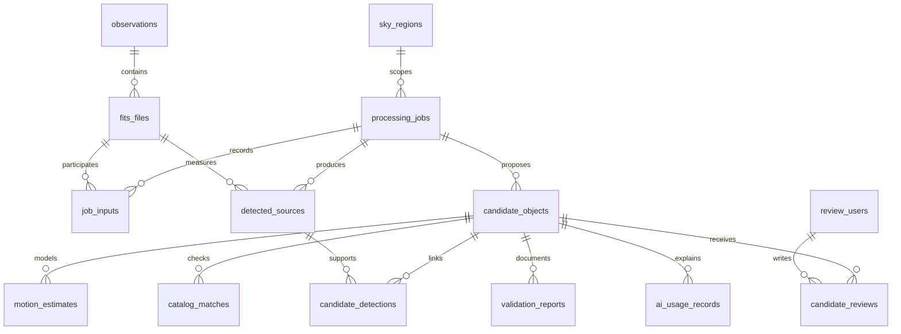

# Modelo de datos

El esquema físico inicial está en `infrastructure/db/001_initial.sql`.
Tiene 13 entidades del brief más `job_inputs`, que preserva la relación muchos a
muchos entre ejecuciones y productos. No hay ORM ni migraciones evolutivas todavía.

UUIDs para identidad; mediciones y parámetros versionados por ejecución. FKs impiden
asociaciones entre candidatos y fuentes de jobs diferentes. Evitar borrados en
cascada que destruyan evidencia. Reportes nuevos generan versión nueva; no reemplazar
originales. Revisiones únicas por usuario/candidato en MVP; historial de revisiones
será una tabla adicional cuando se habilite edición.

Índices iniciales: épocas, posiciones, estados/prioridades, cola y claves únicas de
proveniencia/idempotencia. El B-tree RA/Dec sirve para filtros simples, no resuelve
búsquedas esféricas ni el cruce 0/360. Introducir HEALPix/Q3C tras medir el volumen.

JSONB conserva encabezados, respuestas y matrices sin perder campos originales.
La capa científica debe validar dimensiones, unidades, finitud, positividad de
covarianzas y significado por versión. El SQL no valida estructura interna de JSONB.
Adoptar tipos/constraints más específicos tras inspeccionar FITS reales.
No almacenar matrices FITS, contraseñas o API keys en estas tablas.

`ai_usage_records` permite reservas/cargos, pero requiere una cuenta de presupuesto
con bloqueo transaccional en fase 8; la tabla por sí sola no limita gasto.
