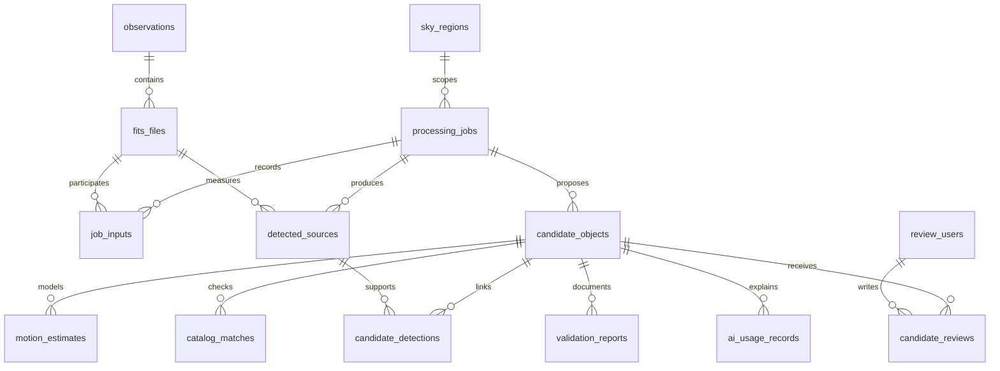

# Data model

The initial physical schema is in `infrastructure/db/001_initial.sql`. It contains
the brief's 13 entities plus `job_inputs`, preserving the many-to-many relationship
between runs and products. There is no ORM or schema-evolution migration layer yet.

Use UUIDs for identity and version measurements/parameters by run. Foreign keys prevent
associations between candidates and sources from different jobs. Avoid cascading deletes
that destroy evidence. New reports create a new version rather than replacing originals.
The MVP allows one review per user/candidate; add a review-history table when editing
is enabled.

Initial indexes cover epochs, positions, states/priorities, queue ordering, and unique
provenance/idempotency keys. The RA/Dec B-tree supports simple filters; it does not solve
spherical searches or the 0/360 wraparound. Introduce HEALPix/Q3C after measuring volume.

JSONB preserves headers, responses, and matrices without losing original fields. The
scientific layer must validate dimensions, units, finiteness, covariance positivity,
and versioned meaning. SQL does not validate internal JSONB structure. Adopt more
specific types/constraints after inspecting real FITS files. Do not store FITS arrays,
passwords, or API keys in these tables.

`ai_usage_records` supports reservations/charges but needs a budget account with
transactional locking in phase 8; the table alone does not enforce a spending limit.
